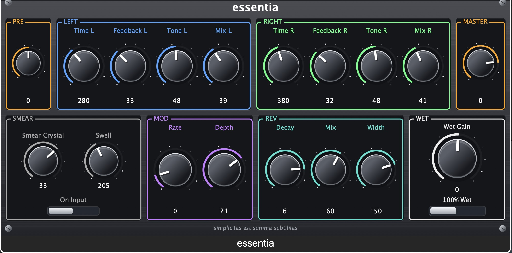

# essentia

Audio plugin (**VST3 + Audio Unit on macOS**, plus a Standalone app) — a
**stereo delay** with independent left/right delay times, feedback, tone and
mix, a bipolar **Smear | Crystal** filter, **Swell** (with On Input toggle),
time modulation, and a **hall reverb fed only by the delay repeats** (every
repeat gets its own reverb tail). Works on any source — guitar, vocals, synths,
buses. Shown as **essentia** in DAWs (file/target names remain `StereoDelayHall.*`).



## Requirements

- macOS 11+ (Big Sur or later), **Xcode** with Command Line Tools
  (`xcode-select --install`)
- **CMake ≥ 3.22** (`brew install cmake`) and **git** — JUCE 8.0.4 is fetched
  automatically by CMake on first configure (needs network once)
- JUCE is dual-licensed AGPLv3/commercial; this repo's code is MIT (see License)

## Quick start (clone → setup → done)

```sh
git clone https://github.com/nicolaconci/delrev.git   # or: gh repo clone nicolaconci/delrev
cd delrev
./setup.sh
```

`./setup.sh` (run from the repo root) fetches JUCE, builds VST3 + AU +
Standalone, runs the DSP unit tests, signs the bundles (ad-hoc), installs them
into `~/Library/Audio/Plug-Ins/` (overwriting any previous install), and builds
the distributable zip `build/essentia-1.0.0.zip`. Then restart your DAW (or
`killall -9 AudioComponentRegistrar`) and look for **essentia** in the effects.

## Install on another Mac (from the zip)

Copy `build/essentia-1.0.0.zip` to the other Mac, then:

```sh
unzip essentia-1.0.0.zip
cd essentia-1.0.0
./install.sh     # installs VST3 + AU into ~/Library/Audio/Plug-Ins (user domain)
```

No admin password, no Apple verification needed for personal use (the zip goes
to the user library; on macOS 10.15+ an unsigned .pkg to the system volume would
be rejected by the Installer). For public internet distribution you'd need an
Apple Developer ID + notarization instead.

## Parameters

The UI is grouped into colour-coded sections — row 1: `PRE | LEFT | RIGHT |
MASTER`, row 2: `SMEAR | MOD | REV | WET` (orange / blue / green / grey /
purple / teal / white).

| Section | Parameter       | Range             | Default | Notes                                                          |
|---------|-----------------|-------------------|---------|----------------------------------------------------------------|
| PRE     | Pre Gain        | -24..+24 dB       | 0 dB    | input gain, before dry/delay/feedback                          |
| LEFT    | Time L          | 20–2000 ms        | 375 ms  | left delay time (log scale)                                    |
| LEFT    | Feedback L      | 0–95 %            | 35 %    | left feedback (recirculating, pre-reverb)                      |
| LEFT    | Tone L          | 0–100 %           | 100 %   | left wet lowpass: 100% bright (~18 kHz, bypass), 0% dark (~300 Hz) |
| LEFT    | Mix L           | 0–100 %           | 30 %    | left dry/wet                                                   |
| RIGHT   | Time R          | 20–2000 ms        | 500 ms  | right delay time (independent)                                 |
| RIGHT   | Feedback R      | 0–95 %            | 35 %    | right feedback (independent)                                   |
| RIGHT   | Tone R          | 0–100 %           | 100 %   | right wet lowpass (independent — e.g. one bright, one dark)   |
| RIGHT   | Mix R           | 0–100 %           | 30 %    | right dry/wet (independent)                                    |
| MASTER  | Master          | -48..+12 dB       | 0 dB    | output volume                                                  |
| SMEAR   | Smear | Crystal | -100..+100 %      | 0 %     | bipolar, applied once to the delay-line input: center off; CCW smear (lowpass); CW crystal (highpass + attack transient + gain compensation) |
| SMEAR   | Swell           | 0–500 ms          | 0 ms    | volume swell-in per repeat (onset detector, time ramp)         |
| SMEAR   | On Input (toggle) | on/off          | off     | also apply the swell to the dry input signal                   |
| MOD     | Rate            | 0.05–10 Hz        | 0.8 Hz  | LFO speed on delay time (log scale), anti-phase L/R            |
| MOD     | Depth           | 0–30 ms           | 4 ms    | delay-time deviation                                           |
| REV     | Decay           | 0.2–10 s          | 3 s     | hall decay, RT60-mapped (log scale)                            |
| REV     | Mix             | 0–100 %           | 35 %    | reverb amount on the repeats only                              |
| REV     | Width           | 0–200 %           | 100 %   | reverb tail width (M/S): 0% mono, 100% full stereo, 200% extra wide |
| WET     | Wet Gain        | -12..+12 dB       | 0 dB    | gain on the wet path only — raise on aux buses at 100% wet     |
| WET     | 100% Wet (button) | on/off          | off     | forces Mix L/R to 100% — aux bus/send (wet-only), knobs untouched |

## Factory presets

Available in the DAW's program/preset menu: **Init** (defaults), **Double Rhythm**
(short offset echoes L 80 ms / R 30 ms, right fully wet), **Ambient** (longer
L 220 / R 300 ms, smear −49, rev mix 35%), **Clean Wide** (L 280 / R 380 ms,
swell 205 ms, crystal +33, rev mix 60%, width 150%).

## v2 features (branch `essentia_v2`)

- **Grit** (0–100 %, box SMEAR): tanh soft-clip saturation on the repeats with a slow RMS
  make-up gain — the perceived volume stays constant and only saturation is added (hot
  peaks are clamped, never louder than without grit). The knob range is compressed on
  purpose: 100 % gives the saturation that the raw amount reached at 80 % (compressed range; the RMS make-up keeps the loudness constant).
- **Mod Vol** (0–100 %, default 100 %, small knob at the bottom of MOD): scales the LFO depth
- **Three small knobs per channel at the bottom of LEFT/RIGHT** — extra "capture & hold"
  pitch line (ICE-style). Pitch chain per channel:
  `original signal → capture/hold → delay at ratio × Time L/R → dedicated hall reverb → Pitch Mix`
  - **Pitch L/R** (−12..+12 st, step 1 st, centered at 12 o'clock, double-click = 0):
    transpose of the captured snippet, read rate `2^(st/12)`; **0 st = bypass**.
    At each **transient** (onset detector, 150 ms refractory) the last 200 ms of the input
    are **frozen and held** (double-buffered, crossfaded over 100 ms on swap — no jump, no
    click; the loop itself wraps with a 100 ms crossfade, half the loop). The loop **period is fixed at
    200 ms regardless of pitch**: at higher pitch a longer slice (200 ms × `2^(st/12)`) is
    captured and read faster, so the hold always lasts 200 ms while sounding transposed.
    Capture refractory 150 ms, plus a periodic re-capture every 200 ms so sustained notes
    stay alive. The gate attack is a long swell-like ramp that scales with pitch
    (~20 ms × read rate, 10–80 ms — ~40 ms at +12 st, where attacks would be most marked;
    release 300 ms); the echo offset is smoothed so Time/Ratio changes glide instead of
    clicking
  - **Ratio L/R** (echo time = multiple of the channel's main delay time, **6 discrete
    steps: `1.5:1`, `2:1`, `2.5:1`, `3:1`, `3.5:1`, `4:1`** — the knob moves in discrete
    steps evenly spread over its rotation (no skew), double-click = `2:1`):
    e.g. Time 200 ms → 300 / 400 / 500 / 600 / 700 / 800 ms
  - **Pitch Mix L/R** (level, default 50 %): applied AFTER the pitch line's own reverb,
    so **at 0 the pitch is completely silent** (dry and tail — output identical to bypass);
    it is also independent of Mix L/R
  The pitch line has its own hall reverb (same Decay/Width) and skips Tone/Grit, which
  act on the main repeats only; the shared main reverb is fed by the main repeats only;
  main Time L/R stays independent.
- All knob value labels are integers, except **Mod Rate** (1 decimal, Hz); the pitch knobs
  show the ratio text (`1:2`, `1:1`, `2:1`, …).

v2 signal flow: `out = ((1-mix)·dry + mix·wet + pitchMix·(pitchEcho + revMix·pitchTail)·wetGain) · master`,
where `wet = (grit(w) + revMix·tail) · wetGain` (main reverb fed by the main repeats only),
and the pitch branch is `signal → capture/transpose/hold → delay at ratio × Time → own hall
→ Pitch Mix` (ratio = 1.5/2/2.5/3/3.5/4 × Time).

## Bus layouts

stereo→stereo, **mono→stereo** (mono insert widens via independent L/R times),
stereo→mono (mixdown), mono→mono. Hosts that don't auto-convert a mono track
(e.g. LUNA) may instantiate mono→mono — set the track to stereo in the DAW, or
use a stereo bus. The plugin also detects a L-only upmix on a stereo bus (right
channel below 0.1% of left) and duplicates it.

## Architecture

```
CMakeLists.txt                        CMake project; JUCE 8.0.4 via FetchContent
setup.sh                              one-command build + test + install + zip
installer.sh                          builds build/essentia-1.0.0.zip (bundles + install.sh)
Source/DSP/DelayHallEngine.{h,cpp}    DSP core in plain C++ (no JUCE, unit-testable)
Source/PluginProcessor.{h,cpp}        AudioProcessor, parameters (APVTS), bus layouts, state
Source/PluginEditor.{h,cpp}           GUI: sectioned controls
Source/LookAndFeel/StudioLookAndFeel.h  hardware-style LookAndFeel (procedural knobs/toggles/panel)
tests/dsp_test.cpp                    DSP unit tests, runnable without JUCE
```

Signal flow (per sample, per channel):

```
input ─► [pre gain] ─┬────────────────────────────► dry ──────────────────────┐
                     │                                                       ├─► out = ((1-mix)*dry + mix*wet) * master
                     └─► [delay line + feedback L/R] ─► d ─► [smear|crystal + swell] ─► w ─┐
                                              │                                            ├─► wet = w*wetGain + revMix*tail
                                              └─► hall reverb (fed by w only) ─► tail ────┘
                                                              (tail width via M/S)
```

## Manual build (details)

```sh
cmake -B build -DCMAKE_BUILD_TYPE=Release
cmake --build build --config Release
# single format:
#   cmake --build build --config Release --target StereoDelayHall_VST3
#   cmake --build build --config Release --target StereoDelayHall_AU
#   cmake --build build --config Release --target StereoDelayHall_Standalone
# universal binary (arm64 + x86_64):
#   cmake -B build -DCMAKE_BUILD_TYPE=Release -DCMAKE_OSX_ARCHITECTURES="arm64;x86_64"
```

Artifacts in `build/StereoDelayHall_artefacts/Release/{VST3,AU,Standalone}/`.
Install manually into `~/Library/Audio/Plug-Ins/VST3/` and
`~/Library/Audio/Plug-Ins/Components/` (ad-hoc `codesign --force --deep --sign -`
recommended), then rescan in the DAW. To change the JUCE version:
`-DJUCE_GIT_TAG=...` (8.0.4 is pinned).

## DSP unit tests (no JUCE needed, any platform)

```sh
g++ -std=c++17 -O2 -I Source tests/dsp_test.cpp Source/DSP/DelayHallEngine.cpp -o dsp_test
./dsp_test
# or via CMake (setup.sh runs them automatically):
cmake --build build --target dsp_test && ./build/dsp_test
```

Covers: dry passthrough, independent L/R repeat positions/amplitudes, reverb
tail only after repeats, modulation (+ mod vol), pre/master/wet gains,
smear|crystal, swell (incl. continuous playing), tone, reverb width,
mono→stereo, stability (no NaN), 48 kHz, grit (constant volume, hot peaks
clamped), pitch capture-hold lines (octave up/down on the captured snippet,
echo at ratio × time, transient gate, mix independence).

## Standalone app and microphone (macOS)

To hear the plugin live (e.g. with the Mac's built-in mic) in the Standalone app:

1. System Settings → Privacy & Security → **Microphone** → enable **StereoDelayHall**
2. System Settings → Sound → Input: **Built-in Microphone**, check the level moves
3. In the Standalone window: **Audio Settings** (speaker icon, top right) →
   Output: Built-in Output, Input: Built-in Microphone, tick input channels In 1/In 2
4. Speak with Mix ~50%: you hear your voice through the delay

## License

The code in this repository is open source under the **MIT License** — see
[LICENSE](LICENSE) (GitHub shows the badge automatically).

Note: **JUCE** is dual-licensed AGPLv3 / commercial (https://juce.com/get-juce/).
Using JUCE under the AGPLv3 is free if you comply with its terms (this repo
open-sources the plugin code); for commercial/closed-source distribution you
need a commercial JUCE licence.
